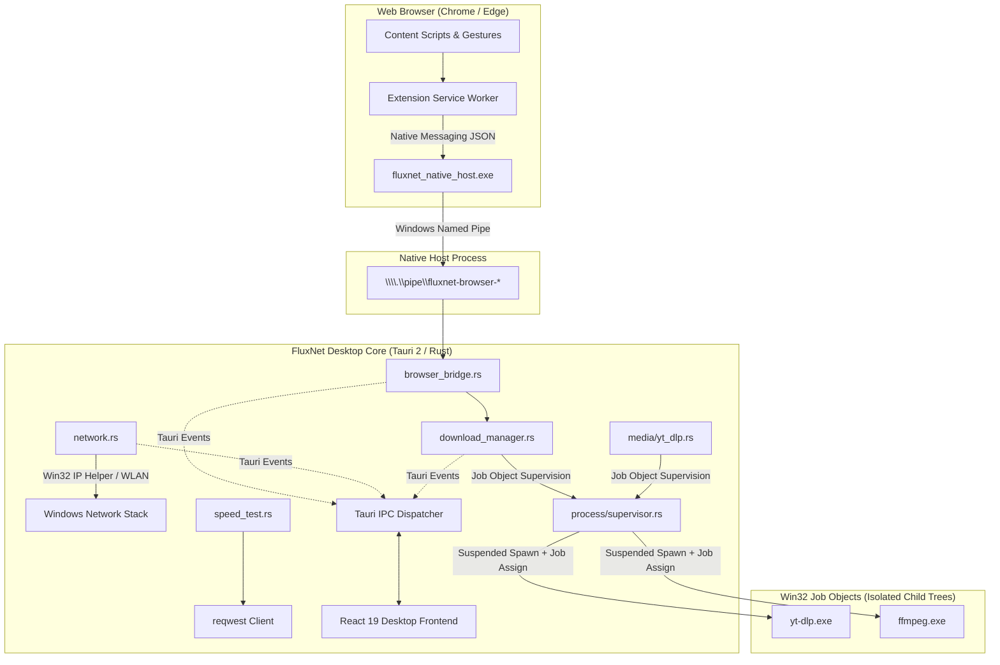

# Architecture Overview

**Analysis Date:** 2026-11-17

## Architectural Pattern
FluxNet employs a **Hybrid Multi-Process Architecture** combining a web-standard UI (React 19) with a native systems core (Tauri 2 / Rust 2024), protected by Windows Win32 Job Object containment and extended into the user's browser via a Manifest V3 extension and a Native Messaging bridge.

---

## System Layers

### 1. Presentation Layer (Desktop UI)
- **Path:** `src/` (`src/App.tsx`, `src/App.css`, `src/main.tsx`)
- **Framework:** React 19 + TypeScript + Vite.
- **Role:** Renders navigation tabs (Dashboard, Interfaces, Speed Test, Analysis, Monitor, Downloads, Settings), real-time charts/metrics, active download tables, and modal dialogs.
- **IPC Interface:** Uses `@tauri-apps/api/core` (`invoke`) for command execution and `@tauri-apps/api/event` (`listen`) for asynchronous real-time event streams.
- **Browser Handoff Integration:** `src/browserHandoff.mjs` handles window focus, confirmation dialogs, and handoff state machine.

### 2. Desktop Application & IPC Boundary
- **Path:** `src-tauri/src/main.rs`, `src-tauri/src/lib.rs`
- **Role:** Initializes Tauri runtime, registers plugins (dialog, updater, process, opener, notification), builds system tray menus, sets up window lifecycle events, and declares the command invocation table.
- **State Registry:** Manages shared application singletons using Tauri's state container:
  - `AppSettingsState` (`app_settings.rs`)
  - `QualityMonitorControl` (`network.rs`)
  - `BdixAnalysisControl` (`network.rs`)
  - `SpeedTestControl` (`speed_test.rs`)
  - `DownloadManager` (`download_manager.rs`)
  - `BrowserBridge` (`browser_bridge.rs`)

### 3. Core Native Subsystems (Rust)

#### A. Process Supervision & Job Objects (`src-tauri/src/process/`)
- **Components:** `windows_job.rs`, `windows_spawn.rs`, `supervisor.rs`
- **Design:** Spawns external processes in a suspended state (`CREATE_SUSPENDED`), binds them immediately to a newly created Win32 Job Object configured with `JOB_OBJECT_LIMIT_KILL_ON_JOB_CLOSE`, and only then resumes the thread.
- **Resilience:** Bounded standard I/O stream buffers (`ProcessStream::MaxBytes`), cancellation token support, and guaranteed child/grandchild process termination on task exit or crash.

#### B. Download & Media Management (`src-tauri/src/download_manager.rs`, `src-tauri/src/media/`)
- **Features:** Segmented multi-connection downloads, byte-range validation, resume capability via strong ETag / Last-Modified headers, HLS fMP4 segment concatenation, and yt-dlp discovery adapter.
- **Sandbox Safety:** `RuntimeTempDir` creates non-reparse temporary workspaces for yt-dlp execution, preventing path traversal or symbolic link redirection.

#### C. Network Diagnostics & Telemetry (`src-tauri/src/network.rs`)
- **Features:** Direct Win32 IP Helper queries (`GetAdaptersAddresses`, `GetIfEntry2`), BDIX route and latency analysis, background network quality monitor service, and WLAN metrics extraction.

#### D. Browser Bridge & Native Messaging (`src-tauri/src/browser_bridge.rs`, `src-tauri/src/bin/fluxnet_native_host.rs`)
- **Features:** Named pipe communication with per-session token validation, caller origin verification for the browser extension ID, and structured resource deduplication.

### 4. Browser Extension Subsystem (`browser-extension/`)
- **Role:** Intercepts media requests, parses streaming manifests (HLS variant playlists, fMP4 playlists, DASH manifests), and handles user download gestures in the browser.
- **Security:** Sanitizes CDN queries, enforces user interaction checks (`download-gesture.js`), deduplicates Instagram/generic blob streams, and hands off valid media URLs to the desktop client.

---

## Key Data Flows

### A. Media Capture & Browser Handoff
1. User clicks or plays media on a webpage.
2. `browser-extension/content.js` and `media.js` validate playable dimensions and manifest structure.
3. `browser-extension/background.js` formats a payload and calls `chrome.runtime.sendNativeMessage`.
4. `fluxnet_native_host.exe` checks caller origin and relays JSON over `\\.\pipe\fluxnet-browser-*`.
5. `browser_bridge.rs` receives payload, verifies auth token, and emits Tauri event to React UI.
6. React UI invokes `prepare_browser_download_dialog` to focus window and queue download in `DownloadManager`.

### B. Supervised Process Execution
1. Downloader or Media Discovery requests execution of an external tool (`yt-dlp`).
2. `supervisor::run_supervised` creates a Win32 Job Object.
3. `windows_spawn` launches process with `CREATE_SUSPENDED | CREATE_NO_WINDOW`.
4. Process handle is assigned to Job Object; process thread is resumed.
5. Standard output/error are collected into bounded memory buffers (`MonitoredOutput`).
6. If cancelled or timed out, closing Job Object handle instantly terminates the entire process tree.

---

## State Management Patterns
- **Frontend:** React local component state and refs in `App.tsx` (managing tabs, metrics, download rows, and alerts).
- **Backend:** Thread-safe state machines using `Arc<RwLock<T>>`, `Arc<Mutex<T>>`, and `AtomicBool` flags for non-blocking concurrent reads and state updates.
- **Persistence:** App settings stored in JSON files under `%APPDATA%\com.administrator.fluxnet\settings.json`.
