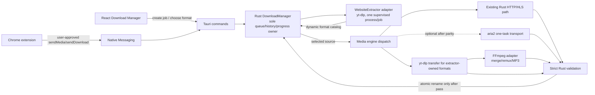

# FluxNet Open-Source Media Engine Integration Audit

**Status:** architecture and integration feasibility review only  
**Date:** 2026-11-16  
**Scope:** repository inspection and design. No production code, dependencies, binaries, workflows, or current Download Manager behavior were changed or executed for this audit.

## Executive recommendation

Keep `DownloadManager` as the only owner of persisted jobs, queue admission, concurrency, history, user-visible progress, pause/resume/retry/cancel, and terminal completion. Introduce per-job backend adapters behind it rather than running an independent aria2 daemon or second queue.

Recommended first integration:

1. Preserve the Rust direct HTTP and finite HLS implementations as the compatibility baseline. They already provide Range/resume, bandwidth limiting, strict response checks, HLS fragment staging, MP4 checks, and atomic rename.
2. Add a supervised yt-dlp adapter for website URL extraction and dynamic format discovery. For website jobs, let that *single job subprocess* own its internal format transfer and FFmpeg postprocessing; Rust still owns the one FluxNet job. Avoid adding aria2 underneath yt-dlp initially: that creates another child process/progress protocol and offers little value until measured.
3. Keep FFmpeg as a separate supervised media-processing adapter for merge/remux/MP3 conversion, with an explicitly selected, license-audited build. Let yt-dlp coordinate a split-stream website download and its merge initially, or deliberately split download and processing only if FluxNet can preserve exact output/progress/cancellation contracts.
4. Evaluate aria2 only as an optional per-task direct HTTP transport in a later phase. It must run as a one-job child, never as a persistent RPC daemon/queue. Do not replace the Rust direct path until resume, range correctness, progress, cancellation, and validator parity are proven.

There is a material redistribution decision: aria2 is GPL-2.0-or-later, and yt-dlp's official PyInstaller Windows executable is GPL-3.0-or-later as a combined work according to yt-dlp's licensing notes. Bundling either alongside FluxNet requires a deliberate licensing/compliance review. FFmpeg can be LGPL-2.1-or-later only with a suitable build; optional GPL or nonfree components change or restrict the licensing position. Treat separately launched executables as lower-coupling than linking their libraries, but do not assume process separation alone resolves redistribution obligations. Obtain legal review before bundling.

## 1. Current architecture findings

### Rust Download Manager

`src-tauri/src/download_manager.rs` implements the current application queue and worker system:

- `DownloadManager` owns persisted entries, controls, concurrency limit, bandwidth limit, and history location.
- `DownloadEntry` is persisted as version 1 and stores status, URL, destination, progress, retries, validators, and HLS playlist/completed-part state.
- Statuses are `Queued`, `Downloading`, `Paused`, `Completed`, `Failed`, and `Cancelled`. Queue execution uses Tokio workers and one application concurrency limiter (default 2, bounded at 4).
- Direct HTTP uses the existing `reqwest` client, partial files, `Range`/`If-Range`, and ETag/Last-Modified validation before resuming. It validates HTTP status/range/body length and does not simply trust a `Content-Length` header.
- HLS accepts a finite, validated playlist model from the browser handoff. The browser bridge currently caps manifests at 1 MiB, HLS segments at 64, and expected bytes at 2 GiB. The Rust worker downloads initialization plus media resources into staging, resumes at completed resource boundaries, assembles in declaration order, validates the output, then renames the partial file.
- MP4 validation parses bounded top-level atoms, checks a valid `ftyp`/`moov`/`mdat` structure and fragmented MP4 initialization/fragment relationships, and performs completion checks before final rename. It is not a general-purpose validator for every media container or codec.
- Pause/resume/retry/cancel and app-exit interrupted-job handling already exist. Current `start_download` accepts a URL and optional HLS model; there is no extractor/format-selection/process stage model.
- The manager emits `download-manager-update` for the UI and owns notifications, history, and user-facing controls. This is the correct integration owner and should remain so.

Relevant code: [download_manager.rs](src-tauri/src/download_manager.rs), especially `DownloadEntry`, `DownloadManager`, `start_download`, `download_worker`, direct response/range handling, HLS worker, validation and lifecycle commands; [browser_bridge.rs](src-tauri/src/browser_bridge.rs).

### Browser extension and Native Messaging

- `browser-extension/background.js` and `media.js` observe/identify eligible media, inspect HLS/DASH manifest metadata, deduplicate resources, request user intent, and send the selected source through Chrome Native Messaging.
- `browser-extension/manifest.json` currently requests `nativeMessaging`, `webRequest`, `downloads`, `tabs`, storage/alarms, plus broad HTTP/HTTPS host permissions and matching content scripts. This audit recommends no permission expansion. A yt-dlp URL job can be submitted by the app UI; the extension may optionally hand off the current page URL only after an explicit user action.
- `fluxnet_native_host.rs` checks the trusted extension origin and frames a bounded message to the app's named pipe. `browser_bridge.rs` validates message shape, pairing code, origin, URL, media type and HLS resource data, then emits `browser-media-detected` and `browser-download-handoff`.
- Browser handoff contains one URL plus media metadata and optional `HlsPlaylist`. `sendDownload` and `sendMedia` are existing message actions. DASH is currently an unsupported report path, not a downloadable queue input.
- Browser manifest fetching uses `credentials: "omit"`; no cookie or credential import should be introduced. Keep the extension as a detector/user-intent bridge, not a second downloader or extractor.

### Existing format gaps

- Direct progressive MP4/WebM is the supported baseline. Resumability depends on server Range support and a stable entity validator.
- HLS has a bounded custom path for a concrete playlist model. It is not a general adaptive HLS engine: master playlist/variant selection, live/event playlists, encryption/key handling, discontinuities and arbitrary subtitle tracks are not established by this code audit.
- DASH is recognized and reported as unsupported. There is no MPD/Representation/SegmentTemplate parser or separate audio/video downloader in production Rust.
- Fragmented MP4 initialization and media fragments are validated only in the supported existing contexts. Instagram byte-range media without a validated HLS playlist is intentionally rejected; no arbitrary byte-range reconstruction exists.
- The repository has `experiments/media-engine-poc` notes and an experimental yt-dlp executable/artifact history. Those results are point-in-time prototype evidence, not production integration or a claim that all sites/formats work. This audit did not execute that binary.

## 2. Proposed integration architecture



Avoid `aria2 --enable-rpc` as a background service: aria2's RPC queue and transfer state would become a second job manager, progress system and persistence format. A process-per-job aria2 adapter avoids that architecture conflict, though its progress protocol and stop/resume behavior still require validation. Existing Rust HTTP remains the default until evidence supports replacing a path.

### 2.1 Unified media source and job contracts

Recommended versioned internal contract (illustrative, not implemented):

```text
MediaSource {
  source_id, origin_kind: Direct | BrowserObserved | Extractor,
  page_url?, media_url?, extractor_key?, format_id?,
  protocol: Http | Hls | Dash | Unknown,
  container?, video_codec?, audio_codec?, width?, height?, fps?,
  estimated_size_bytes?, duration_seconds?, expires_at?,
  has_video, has_audio, requires_merge,
  safe_display_metadata, refresh_policy
}

DownloadTask {
  id, schema_version, input_url, destination, selection,
  status, stage, progress, attempts, timestamps,
  engine_kind, source_snapshot, output_contract,
  cancellation_token, retry_policy, error_code, safe_error
}
```

Rules:

- Persist stable source identifiers, extractor key, selected `format_id`, and safe descriptive metadata; avoid persisting signed URLs longer than needed. Refresh expired format URLs by re-extracting the original public URL on retry, then revalidate the selected format ID/constraints.
- Dynamic resolution list comes from actual extractor formats. Never hardcode a top resolution. Sort discovered choices by real height/fps/codec/size and include Best Available and an explicit missing-quality response. Do not silently substitute a requested quality.
- Track stage separately from queue status: `Extracting`, `AwaitingSelection`, `Downloading`, `Merging`, `Remuxing`, `ConvertingAudio`, `Validating`, `Committing`, and terminal states. UI progress is a normalized manager-owned view of one task, not a second queue.
- Store schema version and engine metadata in download history with migration from current persisted v1 entries. Existing entries must retain old behavior and remain retryable.
- Audio selection records a target bitrate (128/192/256/320 kbps) and source bitrate/codec where discoverable. Never claim that re-encoding a lower-quality source restores detail; hide/disable impossible quality claims or explain that the requested output bitrate may be an upscale in bitrate only.

### 2.2 Dispatch and worker interfaces

Rust owns task creation, admission, state transitions, events, history, retry budget, and finalization. Proposed traits:

```rust
trait WebsiteExtractor {
    async fn probe(&self, url: &Url, limits: &ProbeLimits) -> Result<MediaCatalog, EngineError>;
}
trait MediaEngine {
    async fn run(&self, job: &JobSnapshot, control: &TaskControl,
                 events: &dyn Fn(EngineEvent)) -> Result<StagedOutput, EngineError>;
}
trait MediaProcessor {
    async fn process(&self, input: &StagedInput, operation: &MediaOperation,
                     control: &TaskControl) -> Result<StagedOutput, EngineError>;
}
trait MediaValidator {
    async fn validate(&self, candidate: &Path, contract: &OutputContract)
        -> Result<ValidatedOutput, ValidationError>;
}
```

Use capability-based dispatch (direct HTTP, existing HLS, extractor-owned transfer, optional aria2 direct transfer) based on the selected source and tested support. Do not route every URL through the same engine. yt-dlp JSON extraction can discover website formats; format selection should be explicit and pinned by format ID, with yt-dlp refresh on expiration. For first integration, yt-dlp may download/merge its selected formats itself and report postprocessing stages; adding an aria2 external downloader under yt-dlp is deferred until progress/cancellation/partial-file semantics are demonstrated.

All child invocations must use absolute verified executable paths and argv arrays with shell disabled, a per-job working directory, bounded stdout/stderr, redacted diagnostics, explicit config suppression, no auto-update, no playlist expansion unless the user selects it, no cookie/browser credential flags, and a fixed environment. No arbitrary extractor plugin loading or user-controlled command arguments.

### 2.3 Unified lifecycle, cancellation, retries

```text
URL input
  -> validate scheme/length and destination
  -> classify existing browser source or choose website extractor
  -> extract dynamic catalog (if applicable)
  -> await explicit format/audio selection
  -> create exactly one DownloadManager entry
  -> transfer via selected engine to task-scoped staging path
  -> merge/remux/MP3 conversion if required
  -> strict validation against selected output contract
  -> flush/close, same-volume atomic rename
  -> completed event/history update
```

- Extraction failures do not create phantom completed/downloaded items. Whether extraction itself is a queue entry or a short pre-queue probe is a product decision; recommended: a manager-owned task exists as soon as the user submits the URL and displays an `Extracting` stage so pause/cancel/history cover the complete lifecycle.
- Every process gets an independent wall timeout, idle timeout, stdout/stderr cap and cancellation token. On Windows, use a Job Object with kill-on-close and wait for all descendants; killing only the direct child is insufficient for FFmpeg/yt-dlp child trees.
- Pause is cooperative. For process-based downloaders either signal/stop at a safe point and preserve validated resumable state, or define pause as stop-and-resume with re-probe/restart. Do not show `Paused` until the process tree has exited and partial state is consistent. Retry belongs to Rust; disable/restrict tool-internal retries so attempt counts remain truthful and bounded.
- Preserve partial files only with a resumability contract (strong ETag or equivalent source identity and exact offsets/manifest identity). On changed manifest/format/validator, restart rather than append stale bytes. Failed/cancelled/partial outputs never appear as completed media.
- Errors use typed safe codes (`Network`, `Unavailable`, `Unsupported`, `AccessDenied`, `Timeout`, `Cancelled`, `MergeFailed`, `ValidationFailed`, `DiskFull`, `LicenseConfiguration`) and redacted user messages. Never put signed URL query strings, headers, cookies or full subprocess output into history/events.

### 2.4 Processing, validation, atomic completion

- FFmpeg/ffprobe are adapters, not queue owners. Invoke explicit files with fixed args; no shell; select explicit stream maps/codecs/containers; bound CPU/thread count and time; cap output bytes and temporary disk. Disable network protocols for local-only processing where feasible.
- A strict validator runs after every engine and every transform. At minimum check expected nonempty file, bounded size, recognized container, required stream types/codecs, plausible duration, complete decode/probe success, and no unexpected trailing/truncated data according to format-specific validation. Keep current MP4 validator; add ffprobe as an additional structural/stream check, not a replacement for bounds/atomicity.
- Do not use file extension or process exit code alone as validation. Require successful child exit, closed handles, successful strict validation, flush, then atomic same-volume rename from `.part`/staging. Only then transition to `Completed` and notify.
- If validation, merge, disk flush or rename fails, keep a non-completed status and retain/delete partial output according to explicit retry policy. Never overwrite a valid destination before the new output passes validation.
- MP3 requests require a build with an acceptable MP3 encoder (e.g. LAME has its own license); verify selected bitrate and full decode. If the input source does not carry that much fidelity, preserve source-quality metadata and avoid implying quality enhancement.

## 3. Component choices and tradeoffs

| Component | Recommended role | Benefits | Costs / decision |
|---|---|---|---|
| **Existing Rust HTTP/HLS** | Retain as current default and parity baseline | Already integrated with queue, resume, bandwidth limit, HLS staging, strict bounds and validators | Do not duplicate with aria2 until parity evidence. Expand only where a needed source type is explicitly supported. |
| **yt-dlp** | Website extractor/catalog and, initially, a single supervised website transfer/merge worker | Broad maintained extractor set; dynamic formats; handles website-specific manifests/headers/selection; avoids writing per-site scrapers | Site changes/rate limits/access constraints can break without notice. Standalone Windows exe brings GPLv3+ combined-work obligations; Python wheel has simpler Unlicense package content but adds Python/runtime packaging. Must pin, verify, disable auto-update/config/cookies, and audit exact release. |
| **FFmpeg/ffprobe** | Merge/remux, optional audio extraction/conversion and structural inspection | Mature codec/container support; yt-dlp already integrates with it | Licensing depends on exact build flags and bundled codecs. Large binary; security update burden; process isolation/resource caps needed. Prefer minimal LGPL-compatible build if bundling; a build with GPL or `--enable-nonfree` is not acceptable without explicit legal/product decision. |
| **aria2** | Deferred optional per-task HTTP transport, not default | Mature segmented HTTP and resume features | Directly overlaps Rust HTTP features; GPL-2.0-or-later; parse/progress/cancel/resume and allocation control become separate subprocess concerns. Never use a long-running RPC daemon for the app queue. |

### Prebuilt releases vs source builds

- **Prefer verified official prebuilt releases** for an initial evaluation: fewer toolchain variables, lower maintenance cost, and versioned upstream artifacts. Pin exact immutable URL/version, SHA-256, and verify upstream signatures where published. Hash verification proves byte identity against the chosen pin, not publisher identity unless pin provenance itself is authenticated.
- **yt-dlp:** official standalone Windows `.exe` is straightforward operationally but carries GPLv3+ bundled code per upstream's licensing notes. The wheel/source distribution is stated to contain Unlicense-only yt-dlp code, but requires a separately supplied Python runtime and package dependency closure; the `default` extra includes `yt-dlp-ejs`. Choose only after legal and packaging review. Do not let yt-dlp self-update.
- **FFmpeg:** prebuilt Windows builds are not one uniform license/configuration. Review exact `ffmpeg -buildconf`, `-version`, DLL/dependency list, license files, source availability and signature/hash before selecting. Do not assume a build called “shared” or “full” is LGPL-only. Source builds increase build/reproducibility/maintenance work but give control over enabled components and corresponding source; use only if a license-compatible prebuilt cannot be verified.
- **aria2:** upstream offers Windows binaries, but audit the exact archive contents and bundled libraries/licenses. An upstream Windows ZIP can reduce local build work; it does not remove GPL notices/source obligations. Source build makes dependency/feature selection more auditable but needs its own toolchain/provenance work.

## 4. License compatibility matrix

This is a triage matrix, not a legal opinion. Verify the exact version, binary, transitive package inventory and flags at release time.

| Component/artifact | Upstream license position | Bundling/redistribution implications | Audit action |
|---|---|---|---|
| aria2 source | GPL-2.0-or-later | Redistributing `aria2c.exe` requires GPL notice/license and corresponding source/offer obligations for that binary and covered modifications; overall app combination needs legal review. | Capture upstream source/tag, binary hash, `COPYING`, configure/build options, and all linked DLL licenses. |
| yt-dlp source / PyPI package | Unlicense for yt-dlp source and PyPI source/wheel according to upstream | Easier source license position, but the Python runtime and every included optional dependency retain separate licenses. EJS companion includes Unlicense, MIT (`meriyah`) and ISC (`astring`) in prebuilt wheels. | Prefer wheel only if Python packaging is acceptable; inventory every packaged dependency/license. |
| yt-dlp official PyInstaller Windows executable | Upstream states PyInstaller executables include GPLv3+ code, making the combined executable GPLv3+ | Treat redistribution as GPLv3+; preserve license/third-party notices and corresponding source/offer obligations. Must assess compatibility with FluxNet distribution. | Exact release `THIRD_PARTY_LICENSES.txt`, manifest, hashes/signatures and corresponding source. |
| yt-dlp common bundled dependencies | Varies by release: Python (PSF), certifi (MPL-2.0), Brotli (MIT), mutagen (GPL-2.0-or-later), pycryptodomex (BSD-2-Clause); optional networking/metadata packages add licenses | Exact inclusion varies by artifact and version; bundled standalone executable's GPLv3+ characterization is the controlling upstream notice for the combined artifact, with component notices still required. | Use exact upstream third-party inventory; do not infer from source `LICENSE` alone. |
| yt-dlp-ejs | Unlicense; its prebuilt wheel includes MIT/ISC components | Include EJS and notices if needed for supported extraction, especially current YouTube challenge solver behavior. Keep components local/pinned; no runtime remote fetch. | Pin compatible version and wheel hash; audit embedded notices/dependency metadata. |
| Deno (if selected for yt-dlp-ejs) | MIT | Separate redistributable runtime with its own notice and version/hash requirements. It increases footprint and introduces a network-capable executable; no network permission should be granted to it unless separately justified. | Decide runtime only after test: yt-dlp-ejs documents supported alternatives (Deno, Node, QuickJS); network deny may favor an offline local solver setup. |
| FFmpeg source | LGPL-2.1-or-later baseline, with optional GPL components; nonfree components may make a build undistributable | Exact configure flags and enabled libraries determine obligations. LGPL route typically requires dynamic linking for libraries, source/corresponding changes, notices and relinking rights; a standalone executable still requires applicable license/source notices. GPL build invokes GPL obligations. `--enable-nonfree` builds are not redistributable. | Preserve exact source, configure/build command, buildconf, linked-library inventory, notices and matching source. Legal review of selected binary/build. |
| FFmpeg dependencies/codecs | Mixed (examples: x264 GPL, LAME LGPL; others differ) | Adding a library may change FFmpeg's license or introduce separate terms/patent considerations. MP3 encoder availability/license must be assessed. | Generate SBOM and DLL inventory from the exact artifact; inspect all transitive notices and codec configuration. |
| FluxNet Rust/JS deps | Existing Cargo/npm dependency trees are separately licensed | Not a media-engine license conclusion; no dependencies were changed in this audit. | Include existing app dependencies and new artifacts in release SBOM/notices review. |

Primary references: [yt-dlp README licensing/dependencies](https://github.com/yt-dlp/yt-dlp/blob/master/README.md), [yt-dlp third-party licenses](https://github.com/yt-dlp/yt-dlp/blob/master/THIRD_PARTY_LICENSES.txt), [yt-dlp-ejs license](https://github.com/yt-dlp/ejs/blob/main/LICENSE) and [package metadata](https://github.com/yt-dlp/ejs/blob/main/pyproject.toml), [FFmpeg legal guidance](https://ffmpeg.org/legal.html), [aria2 license and dependencies](https://aria2.github.io/).

## 5. Security and compatibility risks

1. **GPL/distribution compatibility:** Both aria2 and the yt-dlp standalone executable create copyleft obligations; FFmpeg varies by build. No component should be bundled until the exact artifacts/combined distribution model are approved.
2. **Untrusted URL and SSRF:** User/page URLs and extractor-derived formats are untrusted. Validate HTTP(S), reject embedded credentials, localhost/private/link-local/reserved IP targets and unsafe redirects as appropriate; defend against DNS rebinding and redirects to local services. Revalidate every manifest/segment URL and resource count/size.
3. **Subprocess execution:** Extractors parse hostile remote content and can spawn child processes. Use absolute verified paths, argv-only process launch, no shell, no plugins/config, Job Object descendant cleanup, process memory/CPU/time/output limits, and per-task temp directories.
4. **Network access:** yt-dlp performs website network requests by design. Disallow cookies/browser profiles/auth headers by default; never bypass DRM, login gates, paywalls, geoblocking or other access controls. A site denying access is a terminal policy outcome, not a retry workaround.
5. **Signed URLs and sensitive diagnostics:** Extractor JSON/stderr may contain signed CDN URLs, headers, IDs or local paths. Parse machine-readable output and redact secrets before events/history/logs. Store minimum source data and expire it promptly.
6. **Partial/incomplete artifacts:** Process exit is insufficient. Merge, validation, flush and atomic rename must all succeed before `Completed`; stale `.part`/aria2 control files must not be mistaken for usable output.
7. **Resource exhaustion:** Cap total bytes, segment/format counts, duration, concurrent extractor/process jobs, CPU threads, wall/idle time and scratch space. Respect the manager concurrency setting and bandwidth limit; account for temporary duplication during merge.
8. **Drifting websites:** Extractors depend on page APIs and may break, rate-limit, return incomplete format catalogs or change challenge systems. Compatibility must be claimed only for tested site/version/date/source scenarios.
9. **Format/codec mismatch:** A selected stream may not be mergeable into the requested container; requested MP3 bitrate can exceed source quality. Format selection must expose actual codecs and use explicit output contracts.
10. **Windows process cleanup:** Existing Rust task cancellation does not yet imply supervision of a process tree. Implement/test Job Object kill-on-close for both yt-dlp and FFmpeg before production use.
11. **Browser extension scope:** Do not add site-specific permissions, cookies, content scraping or in-extension transfers by default. Continue to pass user-approved URLs/media metadata through the existing Native Messaging bridge.
12. **Instagram fragmented MP4:** Existing code deliberately rejects Instagram byte-range URLs when there is no validated HLS playlist. Browser-observed byte-range responses are not enough to reconstruct a valid stream. Do not concatenate arbitrary ranges or infer fragment boundaries. Resolve through a maintained yt-dlp extractor to a complete format/manifest and let its supported downloader/FFmpeg process it; if it only exposes a structured HLS/DASH/MP4 range representation that the selected engine cannot verify, mark unsupported. A site-specific adapter is permissible only with captured, documented, public/authorized test fixtures and a formal manifest/range model.

## 6. Required modules and likely file changes

No changes were made. This is the likely future layout, subject to approved implementation design:

```text
src-tauri/src/
  download_manager.rs            # keep owner; add stage/engine lifecycle and migration
  media/
    mod.rs                       # engine dispatch and typed contracts
    model.rs                     # MediaSource, MediaCatalog, selection, output contract
    extractor.rs                 # WebsiteExtractor trait and yt-dlp JSON adapter
    process.rs                   # safe process runner, Job Object, bounded output/timeouts
    yt_dlp.rs                    # argv, schema-safe output parse, catalog normalization
    aria2.rs                     # optional single-task transfer adapter; deferred
    ffmpeg.rs                    # remux/merge/MP3 adapter and progress parser
    validator.rs                 # container/stream/decode/size/duration policy
    staging.rs                   # per-task scratch, atomic commit/cleanup
    errors.rs                    # typed errors and safe user-facing messages
  browser_bridge.rs              # versioned handoff accepts input URL/source hints only
src/components/download-manager/
  DownloadManager UI/format picker, stage display, dynamic options
browser-extension/
  existing handoff remains; only update validation/message version if approved
src-tauri/capabilities/           # only if needed; no permission expansion assumed
licenses/ or resources/notices/   # artifact notices/source offer/SBOM per release policy
```

Prefer to add modular files rather than expand `download_manager.rs`, which currently already contains queue, HTTP, HLS and validation logic. The manager delegates a job through one engine interface and consumes normalized events; engine adapters never insert jobs into another app-visible queue.

## 7. Implementation phases

### Phase A — design and legal gates (P0)

- Decide supported license posture and whether GPL components may ship. Select yt-dlp distribution artifact, FFmpeg build strategy, and aria2 necessity.
- Define job schema migration, extractor output contract, stage/progress normalization, output formats, retry/resume rules, redaction policy, resource caps, and exact permission boundary.
- Audit existing extension/native bridge message versioning and app settings impact. Make no behavior change until UX and failure policy are approved.

### Phase B — process and test harness (P0)

- Build a local-only test harness for pinned official tool artifacts with SHA-256 and signature verification where published, third-party inventory, process argv capture, safe logs, timeout/cancel/descendant tests and output containment.
- Establish media fixture set and exact strict validator contract. Confirm Windows Job Object lifecycle.
- No site compatibility claims yet.

### Phase C — yt-dlp discovery prototype (P1)

- Add a feature-gated extractor adapter that probes public user-provided URLs and returns a normalized catalog; do not transfer media initially.
- Test dynamic formats, missing resolution behavior, separate video/audio IDs, live/playlist defaults, extraction expiry, timeout, cancellation, DRM/access-denied classification, no cookies, and log redaction.
- Use representative public authorized test URLs for Instagram, Facebook and YouTube; record exact date, yt-dlp version, result and limitations. No login/private material.

### Phase D — one website transfer path (P1)

- Wire one user-selected format to a single Rust manager task. Use yt-dlp for its own website transfer and merge first; treat this as one worker, not another queue.
- Add manager stage events, process-tree cancellation, bounded retries, output staging, strict validation, atomic commit and history migration.
- Keep direct HTTP/HLS production path unchanged and regression-checked.

### Phase E — FFmpeg operations and audio (P1/P2)

- Add an FFmpeg adapter for supported split audio/video merge and remux. Add MP3 encoding at 128/192/256/320 kbps only for selected sources and verified encoder builds.
- Verify full output decode, stream map, bitrate, duration, limits, process cleanup and no-network processing.

### Phase F — aria2 decision (P2)

- Benchmark against existing Rust HTTP on a controlled test server: byte ranges, redirects, validator changes, resume after restart, server ignores Range, speed, progress accuracy, cancel/pause, hash, file naming, disk cap and bandwidth cap.
- Integrate only if measurable benefit outweighs GPL, process/progress, maintenance and overlap costs. If adopted, use one transient child per manager job; never enable persistent RPC by default.

### Phase G — broader site and release qualification (P2)

- Expand test matrix, platform packaging, update/pinning, SBOM/notices/source obligations, crash recovery and support policy. Publish compatibility as tested site/date/format cases, not generic guarantees.

## 8. Testing strategy and acceptance criteria

All tests must use locally generated fixtures or public media that is explicitly authorized for testing. No credential extraction, login-required content, private browser profiles, DRM, or access-control bypass.

| Area | Test set | Acceptance criteria |
|---|---|---|
| Existing direct MP4/WebM | Stable Range+ETag, Last-Modified, no Range, ignored Range, changed validator, truncated body, redirect, timeout, disk full | Existing path remains behavior-compatible; exact resume only with valid validator/range; incomplete response never `Completed`; failure preserves/restarts according to policy; final output hash/probe passes. |
| Existing HLS | TS and fMP4, init segment, byte-range, malformed/oversized playlist, empty/truncated segment, missing middle segment, separate audio, discontinuity/live/master playlist | Existing accepted finite playlist continues to pass; malformed/unbounded/unsupported playlist fails closed; correct ordering; cancellation cleanup; full decode/probe before atomic commit. |
| DASH | Static MPD with separate audio/video, templates/timeline, init/media fragments, unsupported DRM/encryption, dynamic/live, malformed/hostile URLs | yt-dlp/FFmpeg selects only public supported representations; required streams merge; unsupported/encrypted/access-denied modes fail clearly; no direct custom MPD code unless specifically approved. |
| Instagram | Public/authorized test posts/reels with progressive, HLS, DASH or byte-range source where available; repeat over changed extractor versions | Record exact discovered source/formats. Byte-range fragments are never guessed or concatenated; supported result fully validates; otherwise explicit Unsupported/AccessDenied. No generic Instagram claim until repeatable end-to-end evidence. |
| Facebook | Public/authorized video pages with available qualities and separate audio/video cases | Catalog reflects only returned formats; selection and merge fully validate; denied/private/login-required source is refused without credential workaround. |
| YouTube | Public authorized videos with muxed and split streams, dynamic resolutions, absent requested quality, audio-only | JSON catalog preserves real format IDs and codecs; dynamic choices have no hardcoded maximum; missing quality is not silently substituted; merge output fully validates. Test EJS/runtime behavior with no unauthorized access. |
| yt-dlp process | Huge stdout/stderr, malformed JSON, timeout, cancellation, descendant process, user config/env contamination, auto-update, playlist URL | No shell; process tree exits within bounded timeout; output is bounded and redacted; config/cookie/update behavior disabled; only one manager task exists. |
| FFmpeg and MP3 | split merge, remux, each bitrate, low-bitrate source, unsupported encoder, corrupt inputs, no network | Explicit mappings and bitrate; full decode and probe pass; misleading quality uplift is not claimed; resource/network limits hold. |
| Validation/finalization | Exit success with truncation, wrong extension/container, missing audio/video, corrupted atom/fragment, destination conflict, rename/flush failure | Only validator-approved candidate is atomically committed; every failure remains non-completed; existing completed destination is never clobbered. |
| Lifecycle/history | restart during extraction/download/merge, pause/resume, retry/restart, cancel during each stage, concurrency/bandwidth cap, migration from v1 history | One Rust task owns status, attempts, progress, history and terminal state; process children are reaped; prior downloads still behave; no stale completion events. |
| Browser/native handoff | trusted extension ID/pairing, `sendMedia`, `sendDownload`, expired URL, malformed resource, user-approved page URL | Existing handshake/message flow remains; submitted source is linked to one task; no new extension permissions or cookies; invalid/unsupported source safely rejected. |
| Supply chain/legal | artifact hash mismatch, signature failure, wrong version, license inventory drift, missing source/notices | Fail closed on verification/notice failures; record exact hashes, signatures, versions, flags, SBOM, notices and corresponding source for each distributed binary. |

Minimum release acceptance: 100% of supported-path cases pass; every cancellation/timeout/error case remains non-completed; no child descendants remain; source/download/processing temp files are task-scoped and cleaned or retained by policy; prior direct HTTP/HLS tests pass unchanged; no secrets appear in logs/history; component notices and source obligations are independently reviewed.

## 9. Decisions requiring approval and blockers

### Approval decisions

1. **License posture:** Confirm GPL-3.0-or-later as the intended primary candidate and resolve whether its obligations fit FluxNet's distribution model, including the exact aria2/yt-dlp artifacts. If not, approve an alternative yt-dlp packaging strategy and defer aria2, subject to dependency review.
2. **FFmpeg distribution:** Approve a specific verified LGPL-compatible prebuilt/build and its notices/source offer, or require user-provided FFmpeg. Do not use the prior POC GPL-enabled imageio-ffmpeg binary as a production choice.
3. **Role of aria2:** Defer it until a parity benchmark establishes value, or explicitly fund/accept it as an optional direct transport with GPL compliance and added worker maintenance.
4. **URL UX:** Should every app-submitted page URL immediately create a visible `Extracting` job, or should the user first probe and then queue after format selection? The former better preserves a single lifecycle/history; the latter avoids persisting jobs for abandoned probes.
5. **Playlist/live behavior:** Default playlist expansion off and live streams unsupported until explicit UI/limits/product approval.
6. **Supported website policy:** Approve a public/authorized test policy and support matrix; no credentials/cookies or bypass. Define whether users may provide their own authorized cookies later (not part of this default design).

### Blockers before implementation

- No exact production-approved yt-dlp artifact, FFmpeg build, or aria2 version/license package has been selected.
- Existing manager status model has no extraction/selection/merge/validation stages; history version is currently 1 and needs migration design.
- No process runner with Windows descendant-kill/Job Object guarantees is currently integrated in the Download Manager.
- No production DASH support, broad extractor integration, or dynamic format catalog exists in the app.
- Existing Instagram byte-range sources are explicitly rejected; the source semantics need evidence from the maintained extractor before choosing a path.
- Existing Rust validators are MP4-focused and need a defined contract for WebM/Matroska/MP3 and FFmpeg output probing.
- Progress parsing/normalization for yt-dlp and aria2 has not been implemented or tested against current exact versions.
- Extension supports handoff of observed media but not a versioned arbitrary page-URL extractor job. Native Messaging security/message-size limits and explicit user intent must be preserved.
- Packaging/update, source-offer, SBOM and third-party-notice workflows are not defined for these new executables.
- The repository Phase 0.5 review remains NO-GO for acquisition/build workflow execution; this integration audit does not change that status.

## Community Open Source Licensing Decision

### Project model and primary license candidate

FluxNet's selected direction is a **Community Open Source** project: publish source code for public review and accept community contributions under clear, consistent project terms. **GPL-3.0-or-later is a strong primary-license candidate** because the proposed media stack includes GPL components, it permits community modification and redistribution, and it preserves reciprocal source availability for covered derivative distributions. This is a proposal for review, not a license change: the repository's current license state remains untouched until an authorized legal/product decision and separate implementation approval.

Using GPL-3.0-or-later does not automatically settle every component combination or binary distribution obligation. In particular, legal review must establish the chosen license expression (`GPL-3.0-only` versus `GPL-3.0-or-later`), whether FluxNet's whole distributed application can be consistently offered under that expression, and how the Tauri/WebView application, linked dependencies, separately launched tools, installers, app stores, and source offers are handled.

### Compatibility assessment for the proposed components

| Component/artifact | Project compatibility with GPL-3.0 candidate | Conditions and remaining checks |
|---|---|---|
| **yt-dlp source/PyPI package** | Generally compatible. yt-dlp source and PyPI artifacts are identified upstream as Unlicense. | Preserve Unlicense and all third-party notices for anything copied or bundled. Audit the exact selected artifact and Python/runtime dependency closure. The Unlicense is a public-domain-style dedication; confirm counsel is comfortable with its treatment in every target jurisdiction. |
| **yt-dlp official PyInstaller Windows executable** | Upstream states its PyInstaller executables include GPLv3+ code and the combined executable is GPLv3+. This aligns with a GPL-3.0-or-later candidate at the version-family level. | Retain the exact release's third-party license inventory and comply with corresponding-source and notice requirements. Confirm the precise GPL version/“or later” expression and whether the bundled combination is compatible with the selected FluxNet license. Do not infer that all yt-dlp distribution formats have the same license. |
| **yt-dlp-ejs** | Unlicense with MIT/ISC components in its prebuilt wheels is generally compatible with GPL-3.0 distribution. | Preserve MIT/ISC and other included notices; pin a version compatible with yt-dlp. Avoid runtime downloads of solver code and audit the selected wheel's actual inventory. |
| **aria2** | GPL-2.0-or-later is generally compatible with GPL-3.0 when distributed under GPL-3.0-or-later, because the “or later” grant permits use under GPLv3. | Confirm the exact upstream version/license and dependencies, preserve its notices/source and modifications, and obtain counsel's confirmation for how the executable is combined/distributed with FluxNet. If FluxNet chooses GPL-3.0-only, re-evaluate the “or later” compatibility before including it. |
| **FFmpeg built without GPL/nonfree components** | Its LGPL-2.1-or-later components can generally be used with a GPL-3.0-or-later project, subject to LGPL terms. | Use an exact documented build configuration, preserve LGPL notices and corresponding source, and satisfy applicable relinking/replacement requirements if distributing linked libraries. A standalone executable is still subject to its own notices/source obligations. Counsel should review the application relationship and packaging model. |
| **FFmpeg with GPL components** | Potentially compatible if the selected FFmpeg build and all included GPL dependencies are GPLv3-compatible and the combined distribution obligations are met. | “GPL-enabled” is insufficient evidence. Record exact configure flags, linked libraries, each component's exact license/version, and the applicable GPL version. Avoid GPLv2-only or otherwise incompatible dependencies unless their license grants GPLv3 compatibility. |
| **FFmpeg with `--enable-nonfree` or incompatible/patented components** | **Not approved by this decision.** GPL compatibility does not make an upstream “nonfree” FFmpeg build redistributable. | Reject for FluxNet redistribution unless separate rights and a specific legal analysis establish a lawful distribution path. Do not ship based only on a successful build or a GPL label. |
| **Existing Rust/npm dependencies and future contributions** | Must be assessed as a complete dependency graph; the current audit did not perform a new full license scan. | Inventory direct and transitive dependencies, license expressions, exceptions, generated code and bundled assets. GPL-3.0 at project level does not erase third-party license notices or incompatibilities. |

These are compatibility screening conclusions, not legal advice or a final clearance. Primary references: [yt-dlp licensing and dependency notes](https://github.com/yt-dlp/yt-dlp/blob/master/README.md), [yt-dlp third-party license inventory](https://github.com/yt-dlp/yt-dlp/blob/master/THIRD_PARTY_LICENSES.txt), [aria2 license](https://aria2.github.io/), and [FFmpeg legal guidance](https://ffmpeg.org/legal.html). Recheck the exact immutable versions and package contents when selecting release artifacts.

### Proposed repository licensing and notice structure

Create the following structure only after approval; **do not add or replace these files as part of this audit update**:

```text
LICENSE                         # FluxNet's selected GPL-3.0 expression and full license text
NOTICE                          # Human-readable project copyright, attribution and bundled notices index
CONTRIBUTING.md                 # Contribution workflow, DCO/CLA choice, coding and license rules
COPYRIGHT                       # Optional concise project copyright/authorship record
licenses/
  README.md                     # How to identify artifacts and corresponding source
  third-party.csv (or .json)    # Component, version, license expression, origin, artifact/hash
  third-party/                  # Unmodified license texts and required copyright notices
  source-offers.md              # Source location/offer details for distributed binaries
  sbom/                         # Release-specific SPDX or CycloneDX inventory
```

Structure principles:

- `LICENSE` should identify the exact choice (`GPL-3.0-only` or `GPL-3.0-or-later`), state it applies to FluxNet-authored material subject to existing exceptions, retain existing authors' copyright notices, and include the corresponding complete license text. Do not mark third-party code as FluxNet-owned.
- `NOTICE` should identify FluxNet project copyright holders and attribution known from the source history; list bundled components, versions, licenses, modifications and links to license texts/source. Update it per release artifact because optional components differ between builds.
- Third-party license texts and upstream copyright notices must be preserved as supplied. Do not replace an author's notice with a FluxNet notice or remove attribution when code is modified. Record modifications and upstream origin.
- Ship a machine-readable SBOM and an artifact-specific dependency/license manifest for each installer/archive. Include the exact yt-dlp/aria2/FFmpeg binary hashes, FFmpeg configure flags, bundled DLLs/runtime dependencies, source links and corresponding-source availability.
- `CONTRIBUTING.md` should require contributors to identify third-party material, preserve notices, avoid incompatible dependencies/assets, describe modifications and tests, and agree to the project's contribution terms. It should explain that community contributions are intended to be publicly reviewable and redistributed under the project's chosen license.

### Contributor copyright and licensing terms

Recommended default is **retain contributor copyright and use a Developer Certificate of Origin (DCO)** rather than require assignment of copyright to FluxNet. Each contribution should carry a `Signed-off-by` statement certifying, in substance, that the contributor wrote the change or has the right to submit it, and agrees to submit it under the repository's stated license. The DCO text and sign-off process must be linked from `CONTRIBUTING.md` and enforced consistently.

This preserves authorship attribution while giving the project and recipients the license grant needed to use, modify and redistribute contributions. Do not imply that a DCO transfers ownership. A future CLA or copyright assignment would materially change contributor rights and should require a separate transparent decision and legal review; do not quietly combine DCO and assignment terms. Contributions copied from another project require provenance and license compatibility review before acceptance.

### FluxNet name, logo and brand policy

Treat the FluxNet name, logo, icons, domains, official download links and project identity as **separate brand assets**, not as permission automatically granted by the source-code license. This audit makes **no claim that FluxNet has a registered trademark**. Registration status and ownership have not been established here.

Adopt a written brand/trademark policy alongside the source license. It should:

- Permit truthful, nominative references such as “unofficial FluxNet fork” and compatibility statements, while making clear that code-license rights do not grant the right to present a fork as the official project.
- Reserve “official FluxNet” identity, official logo artwork, release signing identity and project-controlled domains for authorized project maintainers, subject to applicable law and third-party rights.
- Require unofficial forks to use their own product name, icons and visual identity, and to label themselves clearly as unofficial in downloads, installers, websites and documentation. They should not reuse the official logo or mimic official download/update channels in a way that confuses users.
- Define a process for reporting impersonation and requesting permission to use brand assets; avoid promising legal enforcement rights until ownership and applicable trademark law have been reviewed.
- Keep source headers/copyright attribution separate from brand controls. Forks should retain copyright and license notices required by GPL and third-party terms even when changing the product name and artwork.

Before publishing the policy, identify the actual copyright holders/brand owner, review existing logo and domain rights, decide whether to register a mark, and obtain jurisdiction-specific legal advice. Do not represent a proposed policy as proof of registered or enforceable trademark rights.

### Licensing recommendation and remaining legal review

**Recommendation:** proceed with GPL-3.0-or-later as the primary FluxNet license candidate, subject to counsel approval and an artifact-level compatibility inventory. It aligns most directly with the proposed GPLv3+ yt-dlp Windows executable and can generally accommodate aria2's GPL-2.0-or-later license. Prefer a verified FFmpeg build that is demonstrably LGPL-compatible or a fully audited GPLv3-compatible build; reject nonfree configurations for redistribution. Keep the existing Rust Download Manager architecture and queue recommendation unchanged.

Before changing repository files or shipping binaries, obtain legal review of:

1. GPL-3.0-only versus GPL-3.0-or-later and the exact scope for Rust, React/TypeScript, Tauri packaging, installers and app-store distribution.
2. Compatibility of the exact yt-dlp standalone release and all bundled dependencies, or the alternative Python package/runtime distribution.
3. aria2 and its exact Windows binary/dependency licenses, corresponding source, modifications and distribution model.
4. Exact FFmpeg build configuration, GPL/LGPL component closure, MP3 encoder licensing, source/relinking obligations, and any patent or codec distribution constraints.
5. Full Cargo/npm dependency and asset inventory, plus third-party source/notice obligations.
6. DCO wording/process, contributor attribution policy, any existing contributions with unclear ownership, and treatment of generated or copied code.
7. Ownership and permitted use of FluxNet name, logo, icons and domains; wording and enforcement scope for the brand policy. No registration is asserted.

Until these checks are resolved, this is a **licensing direction**, not a repository license change or shipping clearance.

## 10. Source references

Repository findings were read from the current workspace files listed above, including:

- `src-tauri/src/download_manager.rs`
- `src-tauri/src/browser_bridge.rs`
- `src-tauri/src/bin/fluxnet_native_host.rs`
- `src-tauri/src/lib.rs`
- `browser-extension/manifest.json`, `background.js`, and `media.js`
- `src-tauri/Cargo.toml`, `package.json`
- `experiments/media-engine-poc/PROOF_OF_CONCEPT_RESULTS.md`
- `experiments/media-engine-poc/PHASE0_COMPONENT_REPORT.md`
- `experiments/media-engine-poc/acquired/PHASE05_SECURITY_REVIEW_UPDATE.md`

External component facts should be rechecked against the exact pinned release before implementation: [yt-dlp README](https://github.com/yt-dlp/yt-dlp/blob/master/README.md), [yt-dlp EJS guide](https://github.com/yt-dlp/yt-dlp/wiki/ejs), [yt-dlp-ejs package/license](https://github.com/yt-dlp/ejs), [FFmpeg legal page](https://ffmpeg.org/legal.html), [aria2 official page](https://aria2.github.io/).

---

**Audit outcome:** feasible without replacing the Rust queue or browser bridge. The safest incremental path is yt-dlp discovery and one supervised yt-dlp-backed website task, with the Rust Download Manager remaining the only queue and strict validation/atomic commit remaining authoritative. FFmpeg can then be introduced under an approved license profile. aria2 is technically feasible but currently duplicative and should be deferred pending evidence and GPL approval. No production implementation should begin until the decisions and blockers above are resolved.
